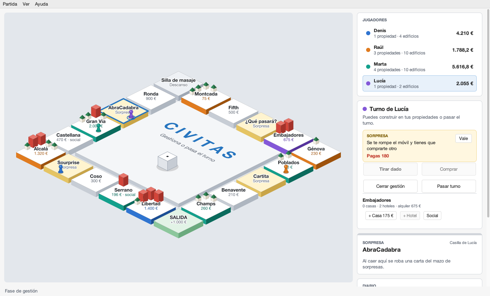
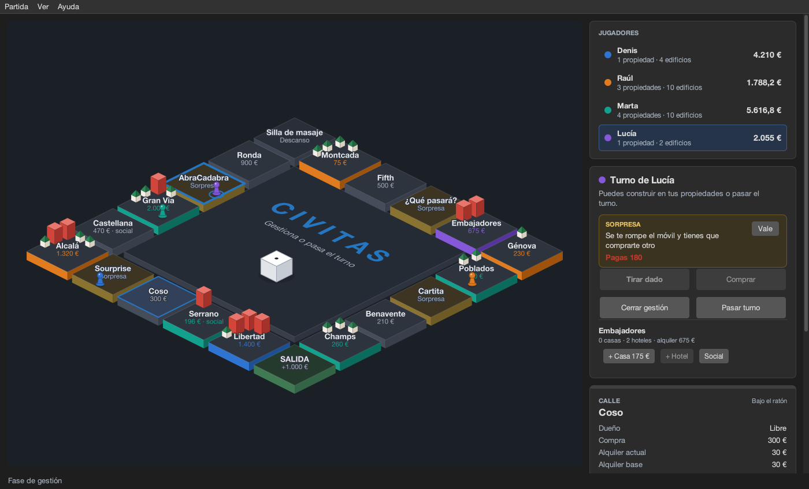
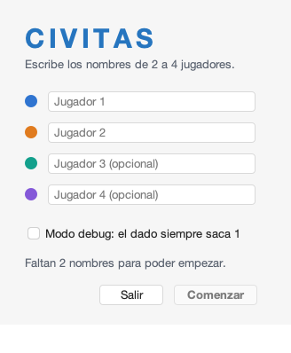

# Civitas

Juego de mesa al estilo Monopoly escrito en Java con el patrón **Modelo-Vista-Controlador**. Lo hicimos en la asignatura de Programación y Diseño Orientado a Objetos (PDOO, curso 2021-22) y después le rehicimos la interfaz: ahora tiene un tablero isométrico animado con Swing y [FlatLaf](https://www.formdev.com/flatlaf/).



## Cómo se juega

- Juegan de **2 a 4 jugadores**. Cada uno empieza con **7.500 €** y cobra **1.000 €** cada vez que pasa por la Salida.
- En tu turno tiras el dado y avanzas. Si caes en una **calle libre** puedes comprarla; si ya tiene dueño, le pagas el alquiler.
- En tus calles puedes construir hasta **4 casas**. Con 4 casas puedes cambiarlas por un **hotel**. El alquiler es `base × (1 + casas + 4 × hoteles)`.
- Puedes convertir una calle en **calle social**, que cobra un 2 % menos de alquiler.
- Las **casillas sorpresa** roban una carta: cobrar o pagar una cantidad fija, pagar o cobrar por cada edificio, o convertirte en **Especulador** (pagas la mitad y puedes construir el doble).
- La partida termina cuando un jugador entra en **bancarrota**. Gana quien tenga más dinero.

## La interfaz

- **Tablero isométrico** dibujado con `Graphics2D`:
  - Cada casilla es una losa con grosor, y sus laterales se pintan del color del dueño.
  - Las casas y los hoteles se dibujan sobre las calles.
  - El dado es un cubo que bota al tirarlo y las fichas avanzan saltando casilla a casilla.
- **Ficha de casilla:** al pasar el ratón por una casilla se resalta y en el lateral se ven su dueño, sus precios, el alquiler actual y los edificios.
- **Lateral:**
  - los jugadores, con su saldo;
  - las acciones del turno, que solo se activan cuando están permitidas;
  - la carta sorpresa que acaba de salir, sin diálogos que bloqueen la partida;
  - la gestión de propiedades, con el coste de cada obra;
  - el diario de la partida.
- **Tema claro y oscuro:** menú *Ver → Tema oscuro* o <kbd>Cmd/Ctrl</kbd> + <kbd>Mayús</kbd> + <kbd>D</kbd>.
- **Atajos:** <kbd>Intro</kbd> tira el dado y <kbd>Cmd/Ctrl</kbd> + <kbd>N</kbd> empieza una partida nueva.
- **Modo debug** al crear la partida: el dado siempre saca 1, útil para probar.

<p>
  
  
</p>

## Ejecutarlo

Hace falta un **JDK 21** o posterior. En macOS, por ejemplo:

```bash
brew install openjdk@21
```

Después, desde la raíz del proyecto:

```bash
./run.sh
```

El script compila el código en `build/classes` y lanza el juego. Usa `JAVA_HOME` si está definido y, si no, el JDK 21 de Homebrew.

También se puede abrir como proyecto de **NetBeans** (Ant): FlatLaf ya está en el classpath y la clase principal es `GUI.CivitasApp`.

## Estructura

```
src/
├── civitas/             Modelo: tablero, casillas, jugadores, sorpresas,
│                        dado, diario y la máquina de estados del turno
├── controladorCivitas/  Controlador por eventos: recibe las acciones de la
│                        vista, las ejecuta en el modelo y refresca la vista
└── GUI/                 Vista en Swing + FlatLaf
    ├── CivitasApp           punto de entrada
    ├── CivitasView          ventana principal (implementa Vista)
    ├── TableroIsometrico    tablero, animaciones y ratón
    ├── Panel*               jugadores, acciones, ficha de casilla y diario
    ├── Dialogo*             nueva partida y fin de partida
    └── Tema                 colores claros y oscuros
lib/
└── flatlaf-3.7.2.jar    look and feel (licencia Apache 2.0)
```

El modelo no depende de la vista. `CivitasJuego` expone qué operaciones están permitidas en cada momento (`puedeAvanzar()`, `puedeComprar()`, `puedeConstruirHotel(ip)`…), y la vista usa esa información para activar o desactivar sus botones. `GestorEstados` decide cómo cambia el estado del turno después de cada operación.

## Autores

Denis Valentin Stoyanov D'Antonio y Raúl Cruz Arévalo.
